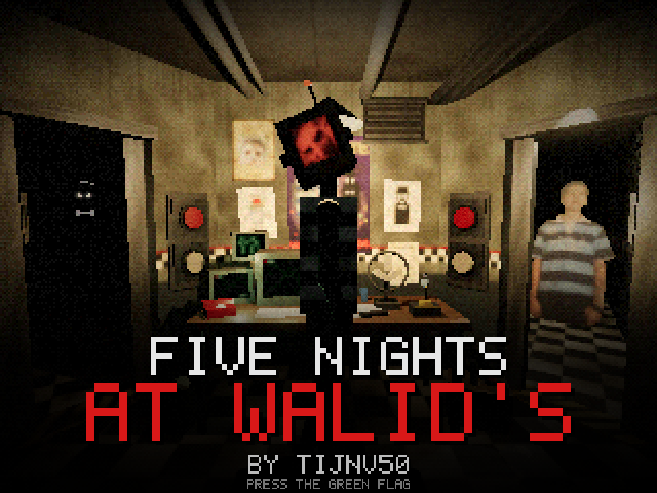
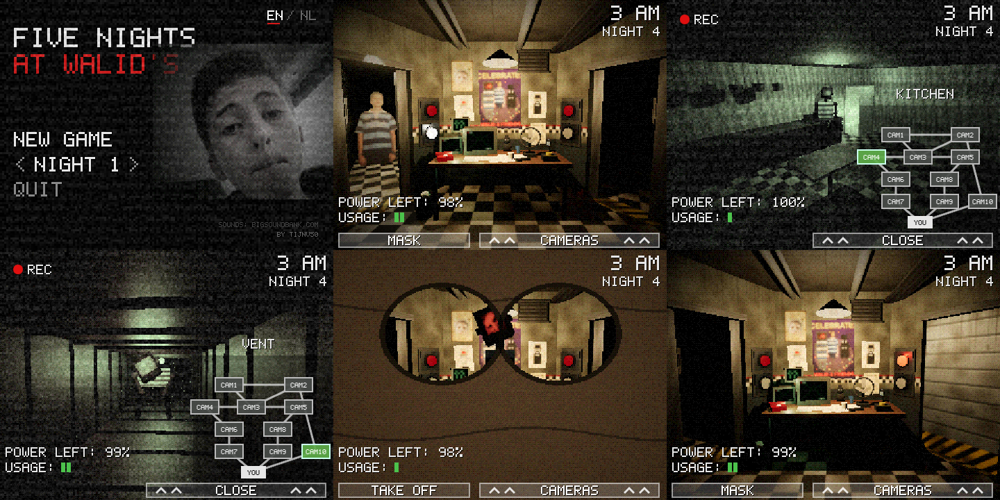

# Five Nights at Walid's

A FNAF-style horror game made in **TurboWarp** (Scratch) by **Tijnv50**.

You've taken the night shift. Watch the cameras, close the doors, keep an eye on your power and survive until 6 AM.
Walid isn't alone: Robo-Walid, Shadow Walid and Scrap Walid all want in. Six nights, a custom night, English and Dutch.

## Download

| Platform | File | How to play |
|---|---|---|
| **Browser** (PC, Mac, iPad, Chromebook) | [`FNAW-web.html`](download/FNAW-web.html) | Download it and open it in your browser. Works offline. |
| **Windows** | [`FNAW-windows.zip`](download/FNAW-windows.zip) | Unzip, then run `five-nights-at-walids.exe`. If Windows warns you, click *More info* → *Run anyway*. |
| **Mac** | [`FNAW-mac.zip`](download/FNAW-mac.zip) | Unzip, then **right-click** the app → *Open* (the first time only; it isn't signed by Apple). |
| **Linux** | [`FNAW-linux.zip`](download/FNAW-linux.zip) | Unzip, then run `start.sh`. |
| **TurboWarp / Scratch file** | [`FNAW.sb3`](FNAW.sb3) | Go to [turbowarp.org](https://turbowarp.org), *File → Load from your computer*, pick `FNAW.sb3`, press the green flag. |

On the download page of a file, press the **download** button (top right of the file view).

The game needs **TurboWarp**: it won't run on scratch.mit.edu (it uses TurboWarp extensions for saving and controllers).

## Controls

Keyboard, touch screen or a game controller: pick yours in the game's **CONTROLS** menu, it shows every button.

## Saving

Your progress (the night you're on and your stars) is saved in the browser / app automatically.
**SETTINGS → RESET SAVE** wipes it.

## Credits

- Game, idea and Walid: **Tijnv50**
- Built with [TurboWarp](https://turbowarp.org) and the [TurboWarp Packager](https://packager.turbowarp.org).
- Sound effects: CC0 recordings and sounds made from scratch.

Fan game inspired by *Five Nights at Freddy's* by Scott Cawthon. Not affiliated with it.
